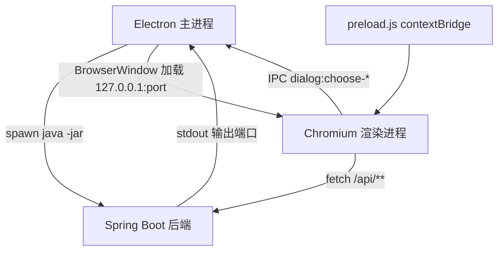

# AGENTS.md

本文件为 Codex (Codex.ai/code) 在本代码仓库中工作时提供指导。

## 项目概述

**Jar Diff Tool** (代码差异比对及分析) — 一个基于 Spring Boot 的桌面工具，用于对比 JAR 文件并可视化差异。支持 Spring Boot fat JAR、BOOT-INF/lib 内嵌 JAR、类文件反编译及详细的文本diff。桌面外壳使用 Electron，后端以独立 Java 进程运行。

## 技术栈

- Java 8, Spring Boot 2.7.18
- ASM 9.6（字节码分析）、Procyon 0.6.0（反编译器）、java-diff-utils 4.12
- Maven 构建
- Vue 3 + Element Plus 前端（作为静态资源由 Spring Boot 提供）
- Electron 44 桌面外壳（`desktop/` 目录，Node.js 构建）

## 构建与运行命令

```bash
# 构建
mvn clean package

# 运行测试
mvn test

# 运行单个测试类
mvn test -Dtest=JarCompareServiceTest

# 仅运行后端（开发调试，浏览器访问 http://127.0.0.1:8085）
mvn spring-boot:run

# 跳过测试打包
mvn package -DskipTests

# 启动桌面应用（需先 mvn package 生成 jar）
cd desktop && npm install && npm start
```

桌面应用启动时由 Electron 主进程拉起 `java -jar` 子进程，端口由 `--server.port=0` 动态分配，窗口加载 `http://127.0.0.1:<port>/`。

## 架构

### 进程结构



### 两阶段比对

1. **JarCompareService**（`core/JarCompareService.java`）— 对两个 JAR 进行快速结构比对。构建 `TreeNode` 层级树，显示每个文件的状态：`added`（新增）、`missing`（缺失）、`modified`（已变化）、`unchanged`（未变化）、`meta`（仅元信息变化）。判等依据是 zip 条目的路径、大小与 CRC32，不进行反编译；文本文件额外做换行与行尾空白归一化比较，`.class` 在前 80 个内用 ASM 签名与字节码指纹判等。

2. **JarDiffService**（`core/JarDiffService.java`）— 按需计算指定文件路径的详细差异。支持：
   - 文本文件（`.java`、`.xml`、`.properties` 等）— 逐行diff
   - `.class` 文件 — 通过 Procyon 反编译后再diff
   - 内嵌 JAR，路径格式如 `BOOT-INF/lib/a.jar!/inner/path`
   - 按会话缓存已计算的差异

### 核心服务

| 服务 | 职责 |
|------|------|
| `JarCompareService` | JAR 结构比对、树结构构建、CRC32 比对 |
| `JarDiffService` | 单文件差异计算、内嵌 JAR 提取、预热缓存 |
| `AsmDecompileService` | 通过 ASM 字节码分析提取类签名（字段/方法名）与字节码指纹 |
| `ProcyonDecompileService` | 将 `.class` 文件完整反编译为 Java 源代码 |
| `DigestService` | MD5 哈希计算 |
| `CompareStore` | 内存存储活跃比对会话及缓存的差异结果 |
| `CompareOptions` | 选项：`includeLib`、`includeClasses`、`includeResources`、`deepCompareLib`、`ignoreGlobs` |

### API 端点（CompareController）

- `GET /api/ping` — 健康检查
- `GET /api/compare/capabilities` — 当前部署允许的能力（是否允许目录比对）
- `POST /api/compare/jars` — 对比两个上传的 JAR 文件
- `POST /api/compare/jars/path` — 按服务器本地路径对比两个 JAR
- `GET /api/compare/diff?id=&path=` — 获取某次比对中指定文件路径的差异
- `GET /api/compare/diff/unified?id=&path=` — 获取统一差异格式文本
- `POST /api/compare/diff/warm` — 预计算已变化文件的差异（异步）
- `GET /api/compare/diff/warm/status?id=` — 查询预热进度
- `GET /api/compare/limits` — 查询各项上限配置
- `POST /api/compare/directory` — 对比上传的目录内容
- `POST /api/compare/directory/path` — 对比服务器文件系统上的两个目录
- `POST /api/compare/directory/summary` — 目录内 jar 级摘要
- `GET /api/compare/nested/tree?id=&outer=` — 展开内嵌 jar 的子树
- `POST /api/compare/files` — 对比两个上传的单文件
- `POST /api/compare/files/unified` — 两个上传单文件的统一差异文本
- `POST /api/compare/files/path` — 按路径对比两个单文件
- `POST /api/compare/files/unified/path` — 按路径取两个单文件的统一差异
- `GET /api/compare/report.json?id=` — 结构化 JSON 报告
- `GET /api/compare/report.v2.json?id=` — 带风险分析的结构化 JSON 报告
- `GET /api/compare/report.html?id=` — 生成独立 HTML 报告（附件下载）

### 数据模型

- **CompareResult** — 包含 `id`、`left`/`right`（FileMeta）、`tree`（List<TreeNode>）、`stats`
- **DiffResult** — 包含 `kind`（"text"/"binary"）、`fileType`、`left`/`right` 行内容、`rows`、`highlights`、`hunks`、`classSummary`
- **TreeNode** — 递归树结构：`value`、`type`（"dir"/"file"/"jar"）、`rightStatus`、`innerChanges`、`children`
- **StoredCompare** — 保存两侧 jar 路径、选项、缓存的差异、已提取的内嵌 jar、预热状态

### 并发控制

`CompareConcurrencyLimiter` + `CompareConcurrencyFilter`（定义在 `CompareController.java` 文件末尾）将并发比对操作限制为 2 个（可通过 `jardiff.concurrency.max-compares` 配置）。若已达上限，POST 到比对端点的请求会被 HTTP 429 拒绝。

### 部署模式

`jardiff.deployment-mode` 只接受 `local` 与 `server`。`server` 模式下禁止目录比对与按路径比对，相关端点返回 403。非法值会让应用上下文启动失败。

### 文件类型检测

根据扩展名和文件魔数判断类型：
- `.class` → "class"（Java 字节码，通过 Procyon 反编译）
- `.jar`/`.zip`/PK 头 → "jar"/"zip"
- 文本扩展名 → "text"
- 其他 → "binary"

### 内嵌 JAR 处理

路径如 `BOOT-INF/lib/a.jar!/p/MyClass.class` 表示位于内嵌 JAR 中的类。JarDiffService 处理流程：
1. 将内嵌 JAR 提取到临时文件（会话内最多缓存 4 个，超出时淘汰任意一个）
2. 将内嵌 JAR 作为 ZipFile 打开
3. 读取内部条目字节进行反编译/diff

### 前端

位于 `src/main/resources/static/` 的 Vue 3 单页应用：
- `index.html` — 页面骨架、样式、脚本加载顺序
- `app/app.js` — 根组件与全部业务逻辑
- `app/api.js` — REST API 调用与桌面桥接
- `app/core.js` — 状态徽标、忽略规则匹配、行渲染工具
- `app/storage.js` — localStorage 持久化

前端选中文件后调用 `/api/compare/diff/unified` 取统一差异文本，交给 diff2html 渲染。

### 桌面外壳

`desktop/` 目录：
- `main.js` — 主进程：端口分配、子进程生命周期、窗口、原生对话框
- `preload.js` — 通过 `contextBridge` 暴露 `window.jardiffBridge`
- `build/icon.png` — 应用图标

文件选择由 Electron 的 `dialog.showOpenDialog` 提供，返回绝对路径，前端继续使用 `/path` 系列端点。

## 配置

`src/main/resources/application.properties`：
- `server.port=8085`（桌面模式由 Electron 覆盖为 0）
- `server.address=127.0.0.1`
- `spring.servlet.multipart.max-file-size=1024MB`
- `jardiff.concurrency.max-compares=2`
- `jardiff.limits.max-warmup-diffs=400`
- `jardiff.deployment-mode=local`
- `jardiff.ignore.default-globs` — 默认忽略规则
