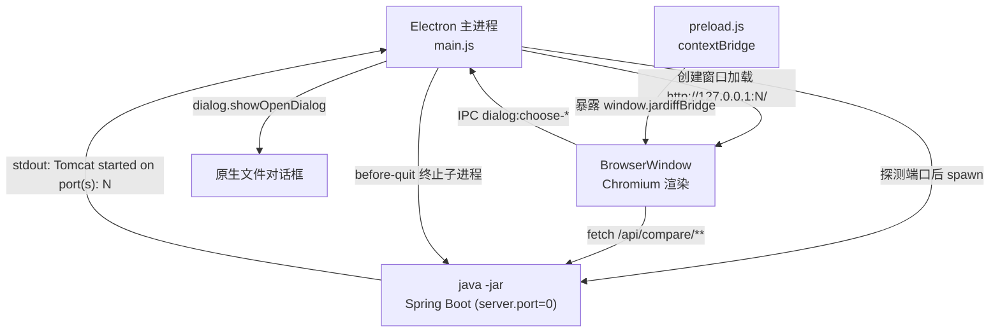

# Jar Diff Tool 桌面外壳迁移到 Electron 与缺陷修复

日期：2026-10-19
状态：待实施
范围：桌面外壳替换、三项与外壳强相关的缺陷修复、其余缺陷记录为待办

## 1. 背景

当前桌面形态是 JavaFX `Application` + `WebView`。`JarDiffLauncher` 启动内嵌 Spring Boot，再用 `WebView` 加载 `http://localhost:<port>/`。文件选择依赖 `FileBridge` 注入 `window.jardiffBridge`，弹出 JavaFX 原生对话框。

这套形态有两个已核实的问题：

1. 产物必须运行在带 JavaFX 的 JDK 上。Oracle JDK 8 自带 `jre/lib/ext/jfxrt.jar`，OpenJDK 发行版通常不含。
2. Windows 上出现过页面空白，同一份代码在 macOS 上正常。

## 2. 已核实的事实

以下事实来自源码阅读与实机执行，作为设计依据。

| 事实 | 证据 |
|------|------|
| JavaFX 只被 2 个文件引用 | `JarDiffLauncher.java`、`FileBridge.java` |
| 业务层与 JavaFX 无关 | `core`、`api` 包内无 javafx 或 netscape 引用 |
| OpenJDK 8 上必然崩溃 | 实跑 Zulu 8（1.8.0_504，`jre/lib/ext/` 无 `jfxrt.jar`）得到 `NoClassDefFoundError: javafx/application/Application` |
| Vue 版本为 3.5.26，依赖 `new Proxy` | `vendor/vue/vue.global.prod.js` 中 `new Proxy` 出现 2 次，无 polyfill |
| 前端无任何 `<input type=file>` | 全仓检索 `type="file"`、`webkitdirectory` 均无命中 |
| 加载地址与监听地址不匹配 | 绑定 `127.0.0.1`（`application.properties:3`），加载 `http://localhost:<port>/`（`JarDiffLauncher.java:88`） |
| 前端只调用按路径比对的端点 | `app.js:563-626` 只用 `compareJarsByPath`、`compareDirectoryByPath`、`compareFilesByPath` |
| 后端已具备完整上传端点 | `/api/compare/jars`、`/api/compare/directory`、`/api/compare/files` 均已实现，前端未接 |
| 现有测试基线全绿 | `mvn -o test` 得 `Tests run: 24, Failures: 0, Errors: 0, Skipped: 0`，耗时 4.245 秒；实施后为 26 个 |
| 本机有验证靶子 | `zulu-8.jdk`（OpenJDK 1.8.0_504，无 JavaFX）、`jdk-21.jdk` |
| Node 构建链可用 | node v23.11.0、npm 10.9.2、pnpm |

## 3. 空白页根因

两条候选成因，均与"Windows 空白、macOS 正常"的现象吻合。

### 成因一：`localhost` 解析与监听地址不匹配

服务端绑定 `server.address=127.0.0.1`，只监听 IPv4。页面加载用 `http://localhost:<port>/`。Windows 的 hosts 默认把 `localhost` 同时映射到 `::1` 与 `127.0.0.1`，解析顺序常把 IPv6 排在前面，连接到 `::1` 会被拒绝，页面因此空白。macOS 默认把 `127.0.0.1` 排在前面。

本机 `/etc/hosts` 中 `127.0.0.1 localhost` 在 `::1 localhost` 之前，与"Mac 正常"一致。

### 成因二：JavaFX 8 的 WebKit 内核过旧

Vue 3 的响应式系统依赖 `new Proxy`。JavaFX 8 内置的 WebKit 大致相当于 Safari 7 至 8 时代，不支持 `Proxy`，Vue 无法初始化，`#app` 保持空节点。项目内没有任何 polyfill。

### 判定方式与实施结论

两条成因都表现为同一现象，判定方式是把加载地址改为 `http://127.0.0.1:<port>/`，重建产物后在 Windows 上运行：

- 页面正常显示：成因一是主因，JavaFX 路线仍可维持。
- 仍然空白：成因二是主因，JavaFX 路线不可维持。

地址修补已实施（`JarDiffLauncher` 的加载地址改为 `127.0.0.1`），产物已重建。Windows 侧实测由同事执行，结论待回填。

无论 Windows 结论如何，Electron 方案对两条成因都是根治：Chromium 内核版本固定，且加载地址由主进程显式写成 `127.0.0.1`。实测已证明这一点——Electron 窗口内 `Vue.version` 为 `3.5.26`，`#app` 渲染出 2569 个字符的内容，不再是空节点。

### 实测记录

在 macOS 上用 Zulu 8（OpenJDK，无 JavaFX）验证：

| 项目 | 结果 |
|------|------|
| 旧产物启动 | `NoClassDefFoundError: javafx/application/Application` |
| 新产物启动 | `Tomcat started on port(s): 18099`，`Started JarDiffApplication in 1.292 seconds` |
| 产物内 javafx 引用 | 0 |
| 源码内 javafx 引用 | 0 |
| Electron 拉起后端 | 解析到端口 53802 与 54078，`did-finish-load` 触发 |
| 窗口内 Vue | `3.5.26`，`#app` 内容长度 2569 |
| 桥接对象 | `chooseJar`、`chooseDirectory`、`chooseFile` 三个方法均在 |
| 旧全局回调 | `__jardiffOnChosen` 已不存在 |
| 全量测试 | 26 个通过，0 失败 |

Electron 二进制经 `npmmirror.com` 镜像下载，缓存目录指向项目内 `.npm-cache/electron`（默认缓存目录在当前环境不可写）。

## 4. 方案取舍

| 方案 | 判定 |
|------|------|
| 保留 JavaFX，仅修 `localhost` | 只能解决成因一。成因二受制于 JDK 内置 WebKit 版本，无法在不换 JDK 的前提下修复 |
| JCEF（内嵌 Chromium）+ Swing | 能固定内核，但需按平台分发约 100MB 原生包，macOS ARM 上配置繁琐，对 JDK 8 支持有限 |
| Electron 外壳（选定） | 渲染引擎与 JDK 彻底解耦，与 deepseek harness 形态一致；代价是引入 Node.js 构建链，安装包增大 |

## 5. 架构



### 职责划分

| 组件 | 职责 | 依赖 |
|------|------|------|
| Electron 主进程 | 端口分配、子进程生命周期、窗口创建、原生对话框、退出清理 | Node.js、Electron |
| preload 脚本 | 通过 `contextBridge` 暴露三个文件选择方法，返回 Promise | Electron IPC |
| 渲染进程 | 现有 Vue 3 前端，逻辑不变 | 现有静态资源 |
| Spring Boot 进程 | 提供静态资源与全部业务接口 | JRE 8+ |

业务层（`core`、`api` 包）零改动。Spring Boot 仍作为静态资源与接口的唯一提供者，前端加载方式不变。

### 边界

主进程不接触任何比对逻辑，只负责进程与窗口。preload 只做能力暴露，不含业务判断。渲染进程通过 HTTP 与后端通信，不直接持有 Node 能力。

## 6. 组件设计

### 6.1 主进程（desktop/main.js）

| 关注点 | 做法 | 理由 |
|--------|------|------|
| 端口分配 | 给子进程传 `--server.port=0`，由操作系统在绑定时刻分配 | 消除预选端口与真正绑定之间的竞态 |
| 就绪判定 | 监听子进程 stdout，正则 `Tomcat started on port\(s\): (\d+)` 取出真实端口，同时作为就绪信号 | 避免窗口先于服务端出现导致连接错误 |
| 就绪超时 | 60 秒上限，超时弹错误对话框并终止子进程 | 防止后端卡住时窗口永久空白 |
| 异常退出 | 子进程非预期退出时弹错误对话框并关闭窗口 | 使用者能看到原因而不是白屏 |
| 工作目录 | `cwd` 设为 `app.getPath('userData')` | logback 的 `logs/` 落在可写位置，不污染安装目录 |
| Java 查找 | 依次尝试 `JAVA_HOME/bin/java`、`/usr/libexec/java_home`（macOS）、PATH 中的 `java` | GUI 应用不继承 shell PATH，macOS 尤其需要 `java_home` |
| 参数传递 | 参数数组交给 `spawn`，不经 shell | 规避 Windows 上含空格与中文的路径问题 |
| 单实例 | `app.requestSingleInstanceLock()`，重复启动时聚焦已有窗口 | 避免两个后端抢端口 |
| 退出清理 | 先发 `SIGTERM`，3 秒未退出再强制结束；Windows 用 `taskkill /PID <pid> /T /F` | 不留残留 java 进程 |
| 平台习惯 | macOS 上 `window-all-closed` 不退出应用，Windows 上直接退出 | 符合各平台习惯 |
| 加载地址 | 显式 `http://127.0.0.1:<port>/` | 不经名称解析，直接规避成因一 |
| 渲染安全 | `contextIsolation: true`、`nodeIntegration: false` | 保持默认沙箱，反编译内容无法触达 Node |

### 6.2 预加载脚本与前端契约（desktop/preload.js、api.js）

现有契约是"同步无返回 + 全局回调 `window.__jardiffOnChosen(path)`"。回调无法穿过上下文隔离边界，改为 preload 暴露返回 Promise 的方法：

```js
contextBridge.exposeInMainWorld('jardiffBridge', {
  chooseJar:       (title) => ipcRenderer.invoke('dialog:choose-jar', title),
  chooseDirectory: (title) => ipcRenderer.invoke('dialog:choose-directory', title),
  chooseFile:      (title) => ipcRenderer.invoke('dialog:choose-file', title)
})
```

主进程侧统一用 `dialog.showOpenDialog`：`chooseJar` 加 `*.jar`、`*.zip`、`*.war` 过滤；`chooseDirectory` 用 `openDirectory`；`chooseFile` 不加过滤。

前端适配只落在 `api.js:150-169` 的三个函数，改为接收 Promise 后回调，并删除 `chosenCallback` 变量与 `__jardiffOnChosen` 全局函数。`app.js` 的调用方式（传回调）不变，无需改动。

### 6.3 IPC 通道

| 通道 | 入参 | 返回 |
|------|------|------|
| `dialog:choose-jar` | `title: string` | 绝对路径字符串，取消时为 `null` |
| `dialog:choose-directory` | `title: string` | 绝对路径字符串，取消时为 `null` |
| `dialog:choose-file` | `title: string` | 绝对路径字符串，取消时为 `null` |

### 6.4 图标资源

新增 `desktop/build/icon.png`，512×512，沿用现有视觉（深色 `#1F2328` 圆角方块 + 白色 `JD`），用 Pillow 生成一次。electron-builder 由它派生 `.icns` 与 `.ico`。现有 `JarDiffLauncher.java:210-231` 的 Java2D 画法随文件删除。

## 7. JavaFX 移除

| 动作 | 对象 |
|------|------|
| 删除 | `src/main/java/com/example/jardiff/JarDiffLauncher.java` |
| 删除 | `src/main/java/com/example/jardiff/FileBridge.java` |
| 修改 | `pom.xml:84` 的 `mainClass` 由 `com.example.jardiff.JarDiffLauncher` 改为 `com.example.jardiff.JarDiffApplication` |
| 删除 | `application.properties:33-34` 的 `jardiff.port.probe-range` 及注释（端口探测已移入 Electron，成为死配置） |
| 新增 | `.gitignore` 追加 `desktop/node_modules/`、`desktop/dist/` |

已确认这两个类的全部外部引用只有 `pom.xml` 的 `mainClass` 一处，删除后无悬挂引用。

## 8. 缺陷修复

本次修复三项与外壳强相关的缺陷。

### 8.1 `fileTextCache` 只写不读

位置：`CompareController.java:76`（字段）、`:575-576` 与 `:647-648`（写入）。

字段是普通 `HashMap`，只有两处写入，全仓无任何读取点，也无 `remove`/`clear`。每次单文件比对都把两侧完整文本留在内存里。Electron 下后端随窗口常驻，泄漏更明显；`HashMap` 在多请求并发写入下也不安全。

处理：删除字段与两处写入。前端在比对后重新上传取差异，删除不影响功能。

### 8.2 `getFileText` 缺少编码回退

位置：`CompareController.java:686-695`。

直接用 UTF-8 解码，非 UTF-8 文本会得到替换字符。`JarCompareService.toText` 与 `JarDiffService.toText` 都有 ISO-8859-1 回退。

处理：与两者对齐——UTF-8 解码后若含 `\uFFFD`，改用 ISO-8859-1 重新解码。

### 8.3 HTML 报告卡片未闭合

位置：`CompareController.java:838-845`。

第 838 行开启 `<div class="card">`（"变化文件"），第 839 行只关闭内部说明 div，随后第 845 行又开启"参数"卡片，前一个卡片从未闭合。按累计计数，`801-897` 行区间结束时 `<div>` 净开 1 个。

处理：在进入"参数"卡片前补上闭合标签。

## 9. 测试

### 9.1 新增回归测试

放在 `CompareControllerIntegrationTest`：

1. `reportHtml_hasBalancedDivTags`：建两个 jar 比对后请求 `/api/compare/report.html`，断言响应体中 `<div` 与 `</div>` 计数相等。
2. `compareFilesUnified_fallsBackToLatin1ForInvalidUtf8`：上传两个含 ISO-8859-1 字节（如 `0xE9`）且内容不同的文件到 `/api/compare/files/unified`，断言返回文本含正确字符且不含 `\uFFFD`。

### 9.2 人工核对清单

Electron 侧无法自动化，按平台核对。

macOS：

- 窗口正常显示，结构树可展开，点击文件出差异。
- 三个文件对话框都能返回路径并驱动比对。
- 关闭窗口后 `pgrep -f jar-diff-tool` 无结果。

Windows：

- 同上，重点确认不再空白。
- 关闭后任务管理器无残留 java 进程。

通用：

- 重复启动时聚焦已有窗口，不起第二个后端。

### 9.3 验收命令

```bash
mvn -o test
mvn -o package -DskipTests
unzip -l target/jar-diff-tool-1.0.0.jar | grep -c javafx        # 应为 0
/Library/Java/JavaVirtualMachines/zulu-8.jdk/Contents/Home/bin/java \
  -jar target/jar-diff-tool-1.0.0.jar                            # 应正常启动
```

## 10. 实施状态

本次范围内的工作已全部完成。

| 项目 | 状态 |
|------|------|
| 加载地址改为 `127.0.0.1` | 已实施 |
| Electron 外壳（`desktop/package.json`、`main.js`、`preload.js`、`build/icon.png`） | 已实施 |
| `api.js` 文件选择改为 Promise 契约 | 已实施，旧 `__jardiffOnChosen` 已移除 |
| 删除 `JarDiffLauncher.java`、`FileBridge.java` | 已实施 |
| `pom.xml` 的 `mainClass` 改为 `JarDiffApplication` | 已实施 |
| 移除 `jardiff.port.probe-range` 死配置 | 已实施 |
| `.gitignore` 追加桌面与缓存目录 | 已实施 |
| 三项缺陷修复 | 已实施 |
| 两个回归测试 | 已实施，全量 26 个通过 |
| macOS 应用包构建 | 已实施，`desktop/dist/mac-arm64/Jar Diff.app` |
| macOS 压缩分发件 | 已实施，`desktop/dist/Jar Diff-1.0.0-arm64-mac.zip` |

### 应用包实测

应用包结构为标准的 macOS bundle：

| 路径 | 内容 |
|------|------|
| `Contents/MacOS/Jar Diff` | 主可执行文件，`Mach-O 64-bit executable arm64` |
| `Contents/Resources/app.asar` | 外壳代码，内含 `main.js`、`preload.js`、`package.json`、`build/icon.png` |
| `Contents/Resources/app/jar-diff-tool-1.0.0.jar` | 后端程序包，与 `target/` 下产物 SHA-256 一致 |
| `Contents/Resources/icon.icns` | 由 `build/icon.png` 转换 |
| `Contents/Frameworks/` | Electron Framework、三个 Helper 与 Mantle、ReactiveObjC |

验证结果：

| 验证项 | 结果 |
|--------|------|
| 解压分发件后启动 | `Tomcat started on port(s): 53092` |
| `open` 双击启动 | 进程存在，Java 子进程监听 `127.0.0.1:52513` |
| 页面标题 | `Jar 版本差异比对` |
| `/api/ping` | `ok` |
| 主进程收到 `SIGTERM` | Java 子进程同步退出，端口释放 |
| 最小环境启动（`env -i`，无 `JAVA_HOME`） | 经 `/usr/libexec/java_home` 找到 JDK 21 并正常启动 |
| 同一进程内 Vue 与桥接 | `vue=3.5.26`，`bridge=chooseJar,chooseDirectory,chooseFile` |

### 遗留事项

1. Windows 侧实测待同事执行，需要确认页面正常显示且关闭后无残留 java 进程。
2. `desktop/main.js` 中渲染进程沙箱设为 `sandbox: true`。当前开发环境的文件沙箱导致 Chromium 沙箱无法初始化，本地验证时用 `--no-sandbox` 与 `--user-data-dir` 临时绕过，这两个参数未写入代码。正式运行环境不受此限制。
3. Electron 二进制与构建工具需经镜像与项目内缓存下载。安装与构建命令为：

```bash
cd desktop
npm install --cache ../.npm-cache
ELECTRON_MIRROR="https://npmmirror.com/mirrors/electron/" \
  electron_config_cache="$(cd .. && pwd)/.npm-cache/electron" \
  node node_modules/electron/install.js

CSC_IDENTITY_AUTO_DISCOVERY=false \
  ELECTRON_BUILDER_CACHE="$(cd .. && pwd)/.npm-cache/electron-builder" \
  ./node_modules/.bin/electron-builder --mac zip \
  -c.electronDist=node_modules/electron/dist --publish never
```

`-c.electronDist` 指向已解包的 `node_modules/electron/dist`，跳过重复下载。DMG 目标依赖 `hdiutil`，在当前文件沙箱下返回“操作不被允许”，需在沙箱外执行 `--mac dmg`。

4. 应用包未签名。首次打开会触发 Gatekeeper 拦截，需要右键打开或执行 `xattr -dr com.apple.quarantine`。给他人分发前需要代码签名与公证。
5. 主进程被 `SIGKILL` 强杀时 Java 子进程会残留。正常退出路径（关闭窗口、`Cmd+Q`、`SIGTERM`）会同步终止子进程。

## 11. 待办缺陷与优化清单

本次不实施，记录于此供后续独立处理。

| 位置 | 问题 | 影响 |
|------|------|------|
| `JarDiffService.java:766` 与 `:1023` | `detectFileType` 与 `looksText` 的扩展名集合不一致，前者不含 `.java`、`.kt`、`.groovy`、`.scala`、`.mf` | `.java` 文件 `kind=text` 但 `fileType=binary` |
| `JarCompareService.java:905-906` | 同一个 `path` 被 `parseNested` 解析两次，`ln` 与 `rn` 完全相同 | 冗余；右侧未取右侧路径 |
| `JarCompareService.java:736` | `classChecked < 80` 只对前 80 个类做字节码判等，顺序由 `HashSet` 遍历决定 | 同一对 jar 多次比对可能出现不同结果 |
| `JarCompareService.java:368-410` | 上传版目录打包未套用忽略规则，路径版在 `:446` 有 | 两种入口的统计与体积上限口径不同 |
| `StoredCompare.java:133-140` | 内嵌 jar 淘汰取 `ConcurrentHashMap` 任意一项，不是 LRU | 热点 jar 可能被反复提取，性能抖动 |
| `StoredCompare.java:20` | `diffCache` 无容量上限与淘汰 | 全量预热后内存持续占用 |
| `CompareStore.java:51-55` | 会话超限直接拒绝，不做淘汰 | 连续第 5 次比对需等 30 分钟 TTL 或重启 |
| `app.js:670-698` 与 `core.js:114` | 后端返回的 `rows`、`highlights`、`hunks` 前端完全不消费，`buildDiffRows` 无人调用 | 后端计算浪费；变更块导航改为从 DOM 反推 |
| `api.js:192-215` | 8 个导出方法在 `app.js` 中无调用点 | 上传版比对、预热、报告功能没有界面入口 |
| `app.js:204` | `v-html` 注入 diff2html 生成的 HTML | 恶意 jar 的反编译内容可能注入脚本；Electron 下虽有上下文隔离，仍建议加 CSP |
| 全仓 | 大量 `catch (IOException ignored)` | 失败原因无法追溯 |
| 全仓 | Java 与 JavaScript 各有一份 `matchesGlob` 实现 | 两处行为可能漂移 |

优化方向：

1. `CompareStore` 默认会话数由 4 提到 16 左右，并加入按最久未使用淘汰。
2. 前端改回消费后端已有的结构化差异，移除对 diff2html 的依赖，变更块导航基于 `hunks`。
3. `matchesGlob` 只保留后端一份，前端通过接口获取匹配结果。
4. `/api/compare/report.v2.json` 与预热接口补前端入口，或明确标为待废弃。

## 12. 假设与依赖

1. Windows 验证依赖同事配合执行一次，这是唯一的跨平台人工环节。
2. npm 可联网安装 `electron` 与 `electron-builder`。若网络不可达需改用内网镜像。
3. 使用者机器需自行安装 JRE 8 或以上，任意发行版均可，不再限定 Oracle JDK。这一点已确认可以接受。
4. macOS 上未做代码签名，分发给他人首次打开会触发 Gatekeeper 提示。正式分发需要签名与公证，本次不含。
5. 现有 24 个测试全绿，作为回归基线。

## 13. 回滚方式

Electron 外壳是新增目录，JavaFX 两个文件在移除步骤才删除。若 Electron 方案不可行：恢复 `JarDiffLauncher.java` 与 `FileBridge.java`、把 `pom.xml` 的 `mainClass` 改回、移除 `desktop/`，即回到当前状态。

`127.0.0.1` 的地址修补可独立保留，它本身修复了真实的跨平台缺陷。
